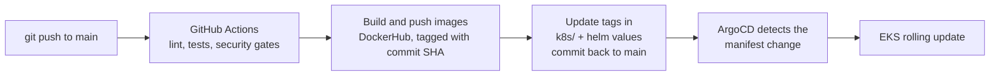

# U2Collab: Real-Time Collaborative Workspace

A full-stack MERN application for real-time collaboration: shared document
editor, infinite whiteboard, and team chat in one workspace.

**Live Demo:** [u2-collab.vercel.app](https://u2-collab.vercel.app)
**GitHub:** [github.com/Mujakkir-Pathan/U2Collab](https://github.com/Mujakkir-Pathan/U2Collab)

## What is U2Collab?

U2Collab is a real-time collaborative platform where teams can work together
on documents, whiteboards, and chat at the same time, with no page refresh or
sync delay. It aims to combine what Notion and Miro do separately.

## Features

| Feature | Description |
|--------|-------------|
| Authentication | Google and GitHub OAuth via Passport.js with HttpOnly JWT cookies |
| Collaborative Editor | Real-time document editing using Yjs CRDT + Tiptap |
| Infinite Whiteboard | Drag, draw, and annotate using Konva.js canvas |
| Real-time Chat | Room-based team chat powered by Socket.io |
| Room Management | Create and join collaborative rooms with unique IDs |
| Secure Sessions | HttpOnly JWT cookies, no localStorage token exposure |

## Tech Stack

### Frontend

- **React.js** (Vite): UI framework
- **Tiptap**: rich text collaborative editor
- **Yjs**: CRDT-based real-time sync engine
- **Konva.js**: infinite whiteboard canvas
- **Socket.io-client**: real-time communication

### Backend

- **Node.js + Express.js**: REST API and WebSocket server
- **MongoDB Atlas**: cloud database
- **Passport.js**: Google and GitHub OAuth strategies
- **Socket.io**: real-time bidirectional communication
- **JWT**: stateless authentication via HttpOnly cookies

## Architecture

```
Client (React/Vite)
      │
      ├── REST API calls ──────────────► Express Server (Node.js)
      │                                        │
      └── WebSocket (Socket.io) ──────────────►│
                                               ├── MongoDB Atlas (data)
                                               ├── Passport.js (OAuth)
                                               └── Yjs (CRDT sync)
```

## CI/CD

Pushing to `main` runs [`.github/workflows/devsecops.yml`](.github/workflows/devsecops.yml):

1. **Gates**: lint, tests, secret scanning, dependency and image scans, Sonar
2. **Build and push**: `mujakkirpathan/u2collab-client` and `mujakkirpathan/u2collab-server`, tagged with the commit SHA
3. **GitOps bump**: the new tags are written into `k8s/` and `helm/u2collab/values.yaml` and committed back
4. **ArgoCD** syncs the change to EKS, CI never touches the cluster directly



## Environment Variables

### Server (`server/.env`)

```env
MONGO_URI=mongodb+srv://...
JWT_SECRET=your_jwt_secret
GOOGLE_CLIENT_ID=your_google_client_id
GOOGLE_CLIENT_SECRET=your_google_client_secret
GITHUB_CLIENT_ID=your_github_client_id
GITHUB_CLIENT_SECRET=your_github_client_secret
CLIENT_URL=http://localhost:5173   # origin of the CLIENT
PORT=5000                          # optional, default 5000
NODE_ENV=development               # dev => cookies work over plain HTTP
```

### Client (`client/.env`)

```env
VITE_API_URL=https://your-server-url
VITE_SOCKET_URL=https://your-server-url
```

Note: Vite env vars must be present at build time, they are baked into the
bundle during `vite build`.

A ready-to-copy template lives at `server/.env.example` and
`client/.env.example`. The Docker Compose flow also uses a root `.env`
(created by `make setup` from `.env.example`) for ports and image tags.

## Running Locally

### Option 1: Docker Compose (recommended)

```bash
# 1. Server config (one time)
cp server/.env.example server/.env   # fill in MONGO_URI, JWT_SECRET, OAuth keys

# 2. Root config + start everything
make setup                           # creates .env from .env.example
make up                              # builds and starts client + server

# 3. Check
open http://localhost:5173
make smoke
```

The client container proxies `/api` and `/socket.io` to the server through
nginx, so no client `.env` is needed in this flow.

### Option 2: Manual (two terminals, no Docker)

Prerequisites: Node.js v18+, a MongoDB Atlas account, and Google and GitHub
OAuth credentials.

```bash
# 1. Clone the repository
git clone https://github.com/Mujakkir-Pathan/U2Collab.git
cd U2Collab

# 2. Setup server
cd server
cp .env.example .env        # fill in your env variables
npm install
npm run dev                 # runs on http://localhost:5000

# 3. Setup client (new terminal)
cd client
cp .env.example .env        # fill in VITE_API_URL and VITE_SOCKET_URL
npm install
npm run dev                 # runs on http://localhost:5173
```

### Other commands

```bash
make down      # stop everything
make logs      # follow the logs
make reset     # wipe and start fresh
make lint      # client ESLint + server syntax check
```

## Running with Docker (manual)

```bash
# Build and run server
docker build -t u2collab-server ./server
docker run --env-file ./server/.env -p 5000:5000 u2collab-server

# Build and run client (VITE vars must be passed at BUILD time)
docker build \
  --build-arg VITE_API_URL=http://localhost:5000 \
  --build-arg VITE_SOCKET_URL=http://localhost:5000 \
  -t u2collab-client ./client
docker run -p 5173:80 u2collab-client
```

## Project Structure

```
U2Collab/
├── client/                  # React + Vite frontend
│   ├── src/
│   │   ├── components/      # Editor, whiteboard, presence, landing page
│   │   ├── pages/           # Home, Login, Dashboard, Room
│   │   ├── hooks/           # useSocket, useYjs, usePresence, useWhiteboard
│   │   └── services/        # REST API client
│   ├── Dockerfile
│   └── nginx.conf           # proxies /api and /socket.io to the server
│
├── server/                  # Node.js + Express backend
│   ├── routes/              # auth, rooms, snapshots
│   ├── controllers/         # request handlers
│   ├── models/              # MongoDB schemas
│   ├── sockets/             # Socket.io handlers (editor, whiteboard, rooms)
│   ├── config/              # DB and Passport strategies
│   └── Dockerfile
│
├── k8s/                     # raw Kubernetes manifests (ArgoCD path)
├── helm/u2collab/           # Helm chart (same app, alternative delivery)
├── gitops/                  # ArgoCD Applications + platform (ESO, cert-manager)
├── terraform/               # EKS + VPC + IAM, S3 remote state
│   └── bootstrap/           # state bucket, run once
├── ansible/                 # bootstrap a deploy machine (optional)
├── scripts/deploy.sh        # one-shot EKS deploy
│
├── docker-compose.yml       # local run: client + server
├── .env.example             # compose settings (make setup)
├── Makefile                 # make setup/up/down/smoke/lint
├── Deploy.md                # full EKS deployment walkthrough
└── .github/workflows/       # DevSecOps pipeline
```

## Deployment

Production runs on **AWS EKS** with GitOps, see **[Deploy.md](Deploy.md)** for
the full walkthrough (`scripts/deploy.sh` shortcuts it).

| Layer | Platform |
|-------|----------|
| CI/CD | GitHub Actions (`.github/workflows/`) |
| Deploy | ArgoCD (GitOps: merge to `main` then sync) |
| Cluster | AWS EKS + Envoy Gateway (Gateway API) |
| Database | MongoDB Atlas |
| Images | DockerHub (`mujakkirpathan/u2collab-client`, `mujakkirpathan/u2collab-server`) |
| Local dev | `make up` (docker compose) |

## Author

**Charan Bavaji**

- GitHub: [github.com/Charan-bavaji](https://github.com/Charan-bavaji)
- LinkedIn: [linkedin.com/in/charan-bavaji](https://linkedin.com/in/charan-bavaji)
